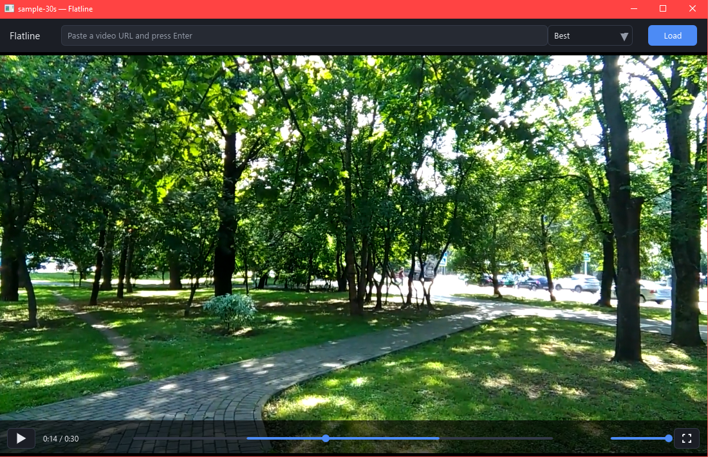

# Flatline

Flatline is a small desktop video player for everything `yt-dlp` can reach —
YouTube, Twitch, Pornhub, Eporner, podcasts, direct `.mp4` links and everything
else the extractors understand. There is no hardcoded list of supported sites:
the player asks `yt-dlp` what is behind a URL and plays the answer.



The interface is deliberately plain: a URL bar on top, the video below it, and
a control bar that floats over the picture.

## What it does

- **Plays any URL `yt-dlp` supports.** The URL is resolved into a catalog of
  streams, the best one is picked, and the player starts.
- **Lets you choose the quality.** The dropdown lists every height the media
  offers, plus *Best* for the highest bitrate.
- **Combines separate video and audio tracks.** When a site only offers split
  streams, the video-only and audio-only formats are joined into one playback.
- **Keeps its own `yt-dlp` up to date.** The first start downloads a private
  copy of `yt-dlp`; every later start checks GitHub for a newer release and
  swaps it in the background. A failed check never blocks the player.
- **Needs almost nothing installed.** On Windows the build downloads `libmpv`
  into the repository; `yt-dlp` is downloaded by the player itself.

## Requirements

| | |
| --- | --- |
| Rust | 1.92 or newer (edition 2024) |
| Windows | the MSVC toolchain (Visual Studio Build Tools) |
| Linux | `libmpv` and its headers, e.g. `libmpv-dev` |
| macOS | `mpv` and its headers, e.g. `brew install mpv` |

Nothing else is needed. `yt-dlp` is provisioned by the player, and on Windows
`libmpv` is provisioned by the build.

## Build

One command builds everything:

```sh
cargo xtask build
```

It provisions `libmpv` (Windows only), compiles the whole workspace in release
mode and collects a runnable player in `dist/`:

```
dist/
├── flatline.exe     the player
└── libmpv-2.dll     the mpv runtime it needs
```

For day-to-day work the debug build is faster:

```sh
cargo xtask build --debug    # or just: cargo build --workspace
```

`cargo xtask` is an alias for the `xtask` crate in this repository, declared in
`.cargo/config.toml`. `cargo run -p xtask -- build` does the same thing if you
prefer to spell it out.

## Run

```sh
cargo run -p app-core                       # an empty player
cargo run -p app-core -- "https://youtu.be/…"   # opens and loads right away
```

The first start downloads `yt-dlp` into the per-user application directory
(`%LOCALAPPDATA%\Flatline\tools` on Windows, `~/.local/share/flatline/tools`
on Linux) and reports what it found on the console.

### Using the player

1. Paste a URL into the bar at the top and press <kbd>Enter</kbd>, or press
   **Load**.
2. While the media is loading, the status line in the middle of the video area
   says what is happening. Errors are shown in red.
3. Open the quality dropdown next to the URL bar to switch to another
   resolution; the change applies immediately.
4. The control bar at the bottom has play/pause, a seek bar with the current
   position and duration, a volume slider and a fullscreen button. Double
   clicking the video area toggles fullscreen as well.

## How it is put together

Flatline is a workspace of small crates. The rule that shapes the whole
repository is:

> **A crate owns exactly one capability, knows nothing about its siblings, and
> can be used, tested and understood on its own.**

The capabilities are wired together in exactly one place — `app-core`, the
composition root — and never sideways between siblings. The rule is not a
convention: `cargo xtask isolation` reads the real dependency graph with
`cargo metadata` and fails when it is broken.

| Layer | Crate | Owns | Depends on |
| --- | --- | --- | --- |
| 0 — vocabulary | `media-model` | media sources, stream catalogs, qualities, playback plans | nothing |
| 1 — capability | `stream-resolver` | turning a URL into a catalog of streams | `media-model` |
| 1 — capability | `playback-engine` | the libmpv wrapper: transport, state, OpenGL renderer | `media-model` |
| 1 — capability | `ytdlp-tool` | finding, installing and updating `yt-dlp` | `media-model` |
| 1 — capability | `storyboard` | cutting preview images out of a media with `ffmpeg` | `media-model` |
| 1 — capability | `ui-kit` | the Slint components, the theme, the widgets | `media-model` |
| 2 — adapter | `video-surface` | binding the mpv renderer into a Slint window | `playback-engine` |
| 3 — root | `app-core` | the window, the wiring, the `flatline` binary | everything |

`video-surface` is the one deliberate exception: the mpv render context has to
be created while a UI toolkit holds an OpenGL context, so the adapter is the
only place where the two meet. It is a thin, documented seam.

The result is that every capability can be tested without a window, a player or
a network connection — `stream-resolver` has nine tests that never start
mpv — and that the look of the player, the way a URL is resolved and the way
video is played can each change without touching the others.

`AGENTS.md` contains the full contract for contributors and agents working on
this repository.

### How the video gets into the window

mpv renders into the default framebuffer, sized to the video area of the
window, and Slint draws its interface on top of that. Two details make it work:

- The frame is rendered with `flip_y = true` and the framebuffer size matches
  the video area exactly, so no intermediate texture, framebuffer object or
  shader is needed. OpenGL's origin is the bottom left, which puts the picture
  exactly below the top bar.
- The parts of the Slint scene that sit over the video are transparent, so the
  mpv frame shows through; mpv paints the letterbox bars itself.

The OpenGL entry points are resolved through the platform loader
(`wglGetProcAddress` on Windows, `glXGetProcAddressARB`/`eglGetProcAddress`
elsewhere) instead of Slint's own resolver, because mpv needs a `'static`
function pointer that outlives the render callback.

### The tools

`yt-dlp` is found in this order: the copy Flatline manages, then one on
`PATH`. If neither exists, the player downloads the current release from
GitHub. On every start a background task compares the installed version with
the newest release and replaces the binary if it is older. Version numbers
like `2025.10.13`, `2025.10.13.post1` and `2025.10.13.dev` are ordered
correctly.

On Windows `libmpv` is downloaded once by `cargo xtask setup` into
`.flatline/deps/mpv` and linked from there — no system installation is
required. The import library is installed as `mpv.lib` so the MSVC linker
accepts it, and `libmpv-2.dll` is copied next to every binary the build
produces.

## Development

| Command | What it does |
| --- | --- |
| `cargo xtask build` | provision, compile in release mode, package into `dist/` |
| `cargo xtask build --debug` | the same without packaging |
| `cargo xtask setup` | only download and unpack `libmpv` |
| `cargo xtask isolation` | check that the crates stay isolated |
| `cargo xtask package` | collect the player in `dist/` |
| `cargo build --workspace` | compile everything, no packaging |
| `cargo test --workspace` | run the tests |
| `cargo clippy --workspace --all-targets -- -D warnings` | lint |
| `cargo fmt --all` | format |

The tests live next to the code they cover. The crates that need an external
program (`yt-dlp`, `ffmpeg`) are tested on their parsing and planning logic
rather than on the program itself.

### Project layout

```
crates/app-core        composition root and the `flatline` binary
crates/media-model     the shared vocabulary
crates/playback-engine the libmpv wrapper
crates/video-surface   the mpv → Slint adapter
crates/stream-resolver URL → streams
crates/ytdlp-tool      finding, installing and updating yt-dlp
crates/storyboard      ffmpeg filmstrips
crates/ui-kit          Slint components, theme and widgets
xtask                  dependency provisioning, isolation check, packaging
docs                   the screenshot in this file
```

## Known limitations

These are real, and they are not hidden anywhere else in the repository:

- **The storyboard is not on the screen yet.** The `storyboard` crate cuts a
  filmstrip out of a media with `ffmpeg` and is covered by tests, but the seek
  bar does not show the preview images yet. The capability is ready, the
  wiring is not.
- **Playlists are truncated.** When a URL points at a playlist, the first entry
  is played; there is no playlist view.
- **Site-specific extractors are not verified here.** The player was developed
  and tested against direct media links. YouTube and other sites that use
  `yt-dlp` depend on the extractors being current, and recent YouTube
  extractors may need a JavaScript runtime (`Deno` or `Node`) that Flatline
  does not install for you.
- **No subtitles, no chapters, no audio-only mode.** The player plays video.
- **The interface is English only**, and there is no settings screen yet.

## License

MIT — see [LICENSE](LICENSE).
